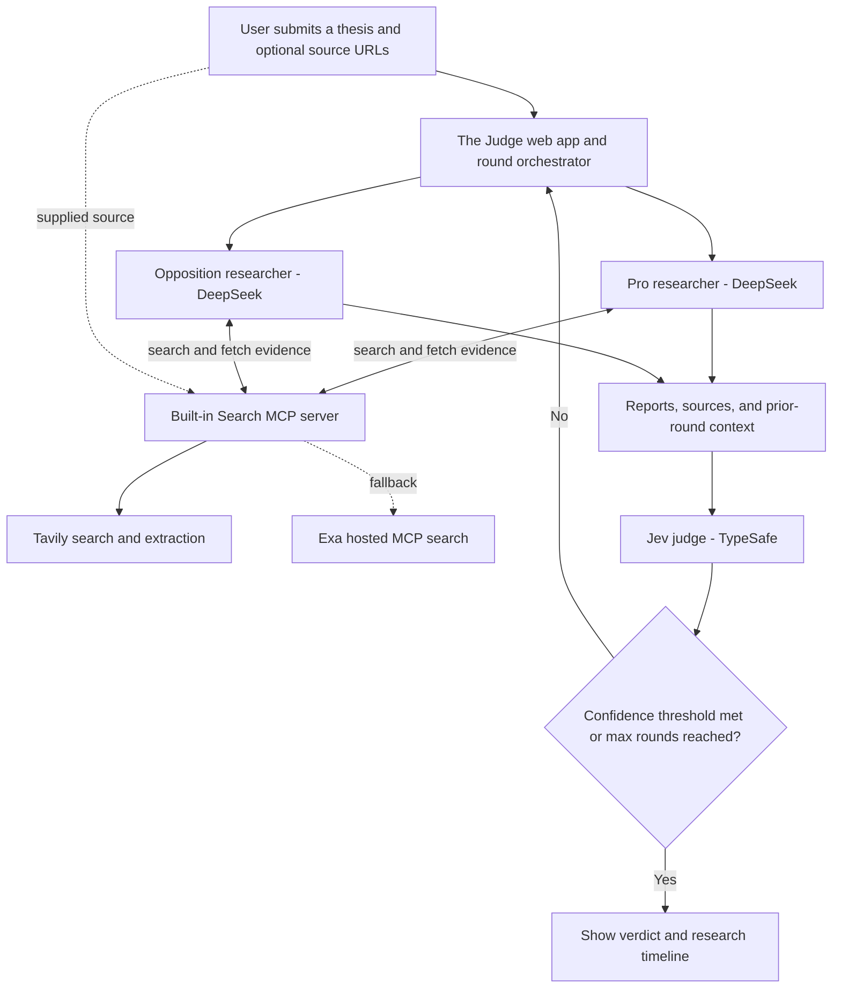
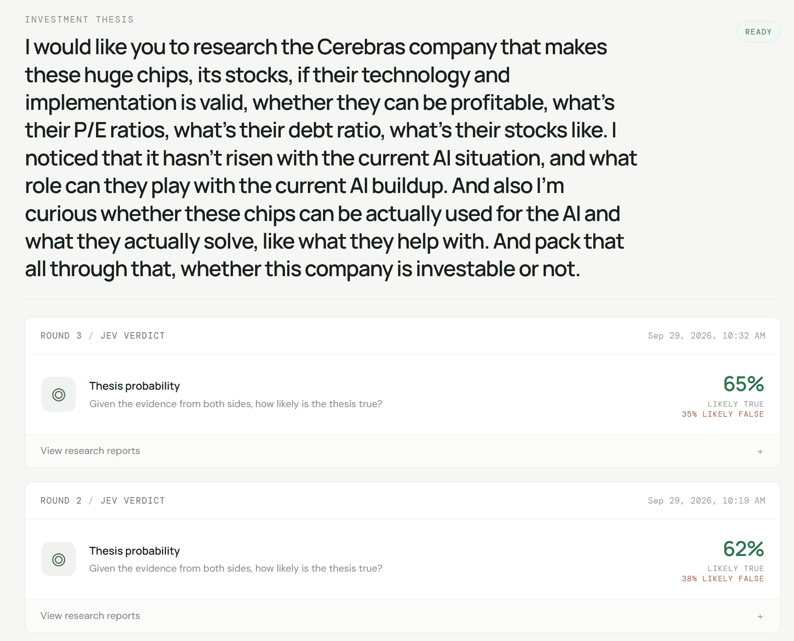

# The Judge

The Judge is a local, Dockerized harness for comparing two possibilities or evaluating a hypothesis with opposing AI researchers and a probability-scoring judge.

The pro researcher gathers evidence in favor of a thesis. The opposition researcher looks for evidence against it and challenges the pro case. Jev, the judge, evaluates both reports against a neutral yes/no question and estimates the probability that the thesis is true. If confidence is below the configured stop threshold, the agents conduct further research using earlier rounds and each other's arguments. The cycle stops when the threshold is reached or the round limit is hit.

The project is primarily an experimental environment for observing iterative AI-agent interaction and exploring whether new arguments, corrections, or patterns emerge through opposition and review. It can also be used to compare investment theses, but the scores are model estimates, not financial advice or proof of truth.

## Harness overview



The diagram shows the normal research flow. The conversation view keeps the reports, evidence links, and Jev verdicts together by round.



*Example research session in The Judge.*

## What a research run does

1. You enter a thesis or question in the browser.
2. The pro and opposition researchers search the web and write sourced reports.
3. Jev scores the evidence against a configurable neutral question.
4. When confidence is below the stop threshold, the agents research again with the prior reports in context.
5. Rounds stop at the confidence threshold or configured maximum. You can inspect reports and sources, add a URL, or manually run another round.

## Requirements

- Docker Desktop with Docker Compose
- The built-in Search MCP server, which Docker Compose starts automatically; no separate MCP server installation is required
- Internet access
- A DeepSeek API key for the researcher agents
- A TypeSafe API key for Jev
- A Tavily API key is optional. Search can use keyless Tavily access with rate limits and falls back to Exa's hosted MCP search service, so internet access to those providers is required.
- A modern web browser

## Quick start

1. Copy the example environment file and add your provider keys:

   ```powershell
   Copy-Item .env.example .env
   ```

2. Edit `.env`. At minimum, set `DEEPSEEK_API_KEY` and `TYPESAFE_API_KEY`. Do not commit this file.

3. Build and start the services:

   ```powershell
   docker compose up --build -d
   ```

4. Open [http://localhost:8088](http://localhost:8088).

To stop the services while preserving saved conversations, run `docker compose down`. To also delete the local conversation database, run `docker compose down -v`.

## Configuration

The example environment file documents the supported variables:

| Variable | Required | Purpose |
| --- | --- | --- |
| `DEEPSEEK_API_KEY` | Yes | DeepSeek chat completions for both research agents |
| `TYPESAFE_API_KEY` | Yes | Jev's probability judgment |
| `DEEPSEEK_BASE_URL` | No | DeepSeek-compatible API base URL; defaults to `https://api.deepseek.com` |
| `DEEPSEEK_MODEL` | No | Research model; defaults to `deepseek-flash` |
| `TYPESAFE_MODEL` | No | Jev model; defaults to `jev-latest` |
| `TAVILY_API_KEY` | No | Tavily search/extraction key; keyless access is attempted when blank |

Agent prompts, Jev's neutral question, maximum rounds, and the confidence stop threshold can be changed in **Agent settings**. Defaults are three rounds and an 80% confidence threshold. The threshold applies to either direction: the run stops when Jev estimates at least that probability for the thesis being true or false.

Conversation history is stored locally in the `judge-data` Docker volume. The app binds its web and search ports to localhost for single-user local use.

## Architecture

- **Web app and orchestration:** FastAPI, with a lightweight browser interface
- **Research agents:** DeepSeek
- **Judge:** Jev through TypeSafe
- **Search:** the app's own Streamable HTTP MCP server, using Tavily with an Exa hosted MCP fallback; it is included in Docker Compose
- **Storage:** SQLite in a Docker-managed local volume

## Limitations

Agent reports and Jev's probabilities depend on the sources retrieved, model behavior, and prompts. Web search services can apply rate limits, especially without an API key. Always review the source links and verify important claims independently. This harness is for research and experimentation; it does not make investment decisions.
